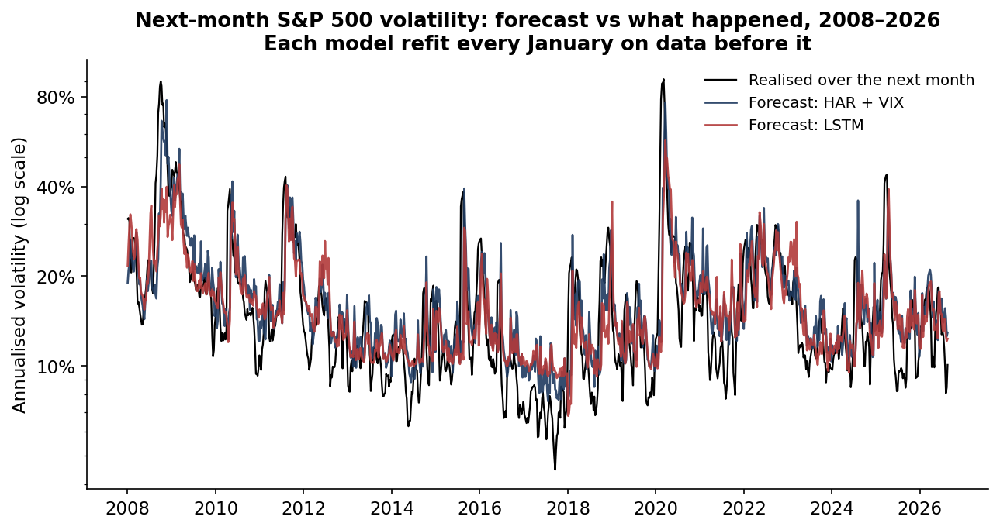
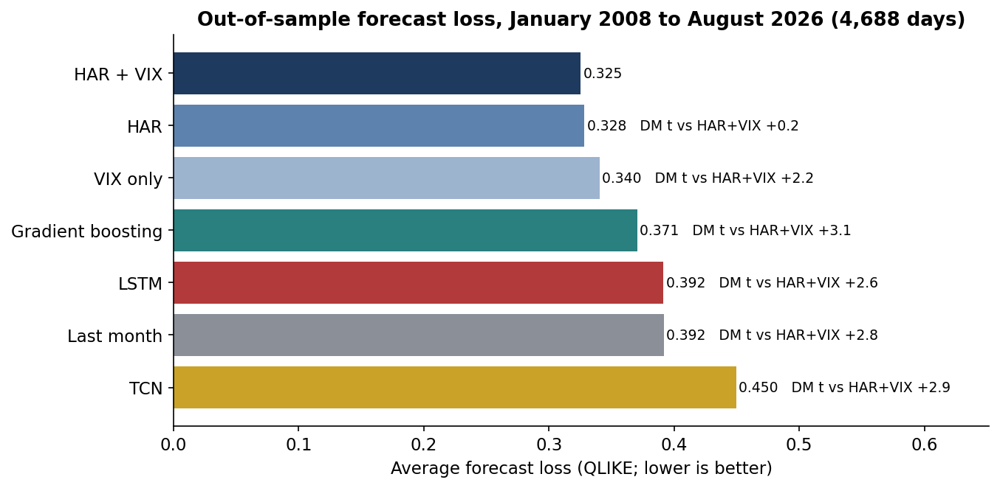
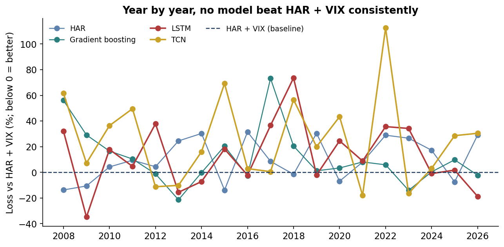
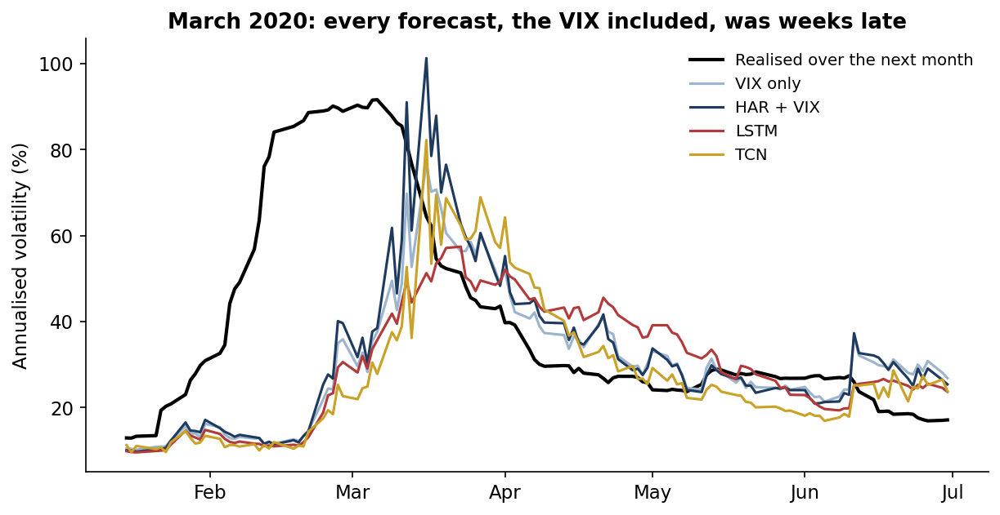
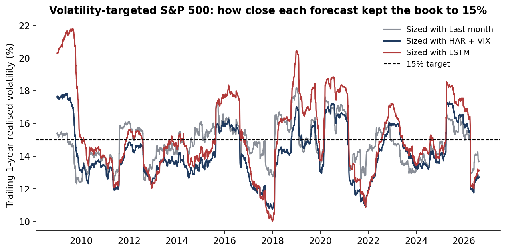

# Can an LSTM beat HAR? Forecasting next-month S&P 500 volatility in PyTorch, 2008–2026

  

**Question.** Volatility forecasts drive position sizing, value-at-risk, margin and option pricing. Can a deep-learning model, an LSTM or a temporal convolutional network (TCN) reading 60 days of raw history, beat the classic HAR model and the VIX at forecasting next-month S&P 500 volatility? Does any gain survive when the forecast is used to size a real book?

**Answer, on real data.** Every model was refit each January from 2008 to 2026 on all earlier data and tested on 4,688 out-of-sample days.

- **The simplest strong model won.** HAR plus the VIX had the lowest forecast loss (QLIKE 0.325). Plain HAR was statistically tied (0.328). The LSTM's loss was 20% higher (0.392; Diebold–Mariano t = 2.6, p = 0.01), and the TCN's 38% higher (0.450). Gradient boosting on the same inputs as HAR + VIX also lost (0.371).
- **The networks won calm years and lost the crises.** The LSTM beat HAR + VIX in 7 of 19 years, all of them calm. It lost by 32% in 2008, 73% in 2018 and 25% in 2020. On the 337 days when realised volatility was above 30%, the LSTM under-forecast by 19.0 points on average, against 13.6 for HAR + VIX.
- **Every forecast was weeks late in March 2020**, the VIX included.
- **For sizing, accuracy was not the whole story.** Targeting 15% volatility with any forecast cut the S&P 500's worst drawdown from 53% to between 28% and 36%, and lifted the Sharpe ratio from 0.45 to between 0.51 and 0.55.
  - The plain trailing-month estimate kept the book closest to target, missing by 1.2 points a year on average, against 1.8 for HAR + VIX and 2.1 for the LSTM.
  - Sizing with the LSTM instead of HAR meant a worst drawdown deeper by 3.8 points: $38M per $1bn.
- **Tails were under-covered by every model.** A 99% one-day VaR from these forecasts was breached 1.5% of the time with HAR + VIX, 2.0% with the LSTM and 2.5% with the TCN.

Full write-up: https://www.guptagaurav.info/articles/can-an-lstm-beat-har

## Results

| Forecaster (walk-forward, Jan 2008 – Aug 2026) | QLIKE (lower is better) | MSE, log variance | Mincer–Zarnowitz R² | Diebold–Mariano t vs HAR + VIX | Years better than HAR + VIX |
|---|---|---|---|---|---|
| HAR + VIX + leverage | **0.325** | 0.411 | 0.58 | n/a | n/a |
| HAR (daily, weekly, monthly) | 0.328 | 0.460 | 0.53 | +0.2 (p 0.83) | 6 of 19 |
| VIX only | 0.340 | 0.424 | 0.57 | +2.2 (p 0.03) | 8 of 19 |
| Gradient boosting (HAR-X inputs) | 0.371 | 0.470 | 0.52 | +3.1 (p 0.002) | 6 of 19 |
| LSTM, 60-day sequences (PyTorch) | 0.392 | 0.474 | 0.51 | +2.6 (p 0.01) | 7 of 19 |
| Last month's realised (random walk) | 0.392 | 0.593 | 0.48 | +2.8 (p 0.005) | n/a |
| TCN, 60-day sequences (PyTorch) | 0.450 | 0.503 | 0.48 | +2.9 (p 0.003) | 4 of 19 |

| 15% volatility-targeted SPY, sized with… | Return a year | Volatility | Sharpe | Worst drawdown | Average yearly miss vs 15% | 99% one-day VaR breach rate |
|---|---|---|---|---|---|---|
| Buy and hold (no targeting) | 9.0% | 19.8% | 0.45 | −53.0% | 6.0 pts | n/a |
| Last month's realised | 8.0% | 14.8% | 0.54 | −28.0% | **1.2 pts** | 2.0% |
| HAR | 8.0% | 14.5% | **0.55** | −30.3% | 1.7 pts | 1.7% |
| HAR + VIX | 7.6% | 14.3% | 0.53 | −32.6% | 1.8 pts | **1.5%** |
| LSTM | 7.9% | 15.4% | 0.51 | −34.2% | 2.1 pts | 2.0% |
| TCN | 8.2% | 16.1% | 0.51 | −36.3% | 2.0 pts | 2.5% |







## Method

- **Daily variance proxy.** The overnight squared return plus the Garman–Klass range estimator from SPY's daily open, high, low and close.
- **Target.** The log of average daily variance over the next 22 trading days.
- **Inputs, known at the close.**
  - HAR: log variance over the last 1, 5 and 22 days.
  - HAR-X adds the log VIX (as a daily variance) and the negative parts of the 1-day and 5-day returns (leverage effect).
  - The sequence models read 60 days of `[log variance, log VIX, return]`, standardised with training statistics only.
- **Models.**
  - Ordinary least squares (HAR, HAR-X, VIX only).
  - LightGBM on the HAR-X inputs.
  - A one-layer LSTM (32 units).
  - A 4-level causal dilated TCN (32 channels).
  - Both networks are trained in PyTorch with Adam on MSE for 30 epochs, with gradients clipped. Each is averaged over three seeds, with deterministic algorithms.
- **Walk-forward.** Each model is refit every January from 2008 on all earlier days, minus a 22-day embargo so that no training target overlaps the test year. A code assertion enforces the embargo. Forecasts are converted back to variance with a log-normal bias correction estimated in training.
- **Scoring.**
  - QLIKE (Patton, 2011) and MSE on log variance.
  - Diebold–Mariano against HAR + VIX, with Newey–West errors (22 lags).
  - A 15% volatility-targeted SPY book: weekly rebalance, leverage cap 2, 2 bp per unit of turnover, price returns.
  - Coverage of a normal 99% one-day VaR, with a Kupiec test.
- **Hardware and time.** CPU only, 2 threads (Intel Xeon, 2.1 GHz). The full walk-forward (19 refits × 7 models, 3 seeds per network) took about 36 minutes.

## The commercial case

The deliverable a bank, asset manager or volatility desk would actually buy is not a new forecaster. It is a **challenger lab**: a standard, reproducible way to test any proposed volatility or risk model against a strong baseline before it reaches production. Model-risk rules already expect challenger models, and teams are being pitched machine-learning risk models daily.

| Element | Detail (illustrative where stated) |
|---|---|
| Who pays | Model-risk and validation teams at banks and insurers; CROs at asset managers and hedge funds; volatility-targeting and risk-parity product teams |
| Problem in dollars | Sizing a $1bn volatility-targeted book with the LSTM instead of HAR would have deepened the worst drawdown by $38M. On stressed days the LSTM's lower forecast understated 99% one-day VaR by about $7.9M per $1bn of S&P exposure compared with HAR + VIX (5.4 vol points ÷ √252 × 2.326) |
| Product | A walk-forward challenger harness: embargoed refits, seed averaging, QLIKE / Diebold–Mariano, decision tests (sizing, VaR), and a validation report a model-risk committee can sign |
| Proof | This repository: 7 models, 19 annual refits, 4,688 out-of-sample days, every number reproducible |
| Build vs buy | 6–8 weeks to wrap the harness around a client's data and models (one quant, one engineer) |
| Pricing logic (illustrative) | $40–80k per model validation, or $150k a year for a standing challenger service. That is small against a single avoided $38M drawdown or a capital charge on understated VaR |
| Adoption risks | Clients' own data and model access; the validation team's independence requirements |
| Client KPIs | Models rejected before production, Diebold–Mariano significance, VaR coverage, time to validate |

## Limits

- **Daily data.** The variance proxy is range-based from daily OHLC, not intraday realised variance. The networks might do better with intraday data or many assets. That is a separate, pre-registered test.
- **One index, one horizon.** S&P 500 (SPY), one-month horizon. The VIX closes at 4:15 pm ET, slightly after the equity close. With a next-day-onward target this does not leak, but it is noted.
- **Hyperparameters.** These were fixed before results and not tuned on the test years. A tuned network could do better in-sample, and it is exactly what a validation team should be sceptical of.
- **Vol-target backtest.** It uses price returns and excludes dividends and financing.
- Independent research on public data. It is not investment advice and has not been deployed.

## Data and citations

Data
- SPY daily open, high, low and close: Yahoo Finance, via [huggingface.co/datasets/defeatbeta/yahoo-finance-data](https://huggingface.co/datasets/defeatbeta/yahoo-finance-data) (ODC-BY).
- CBOE Volatility Index (VIX) daily close: Cboe Global Markets. Copy used: [github.com/datasets/finance-vix](https://github.com/datasets/finance-vix) (data/vix-daily.csv; ODC-PDDL-1.0).
- Both files are pinned by sha256 in `configs/default.yaml`.

Methods referenced
- Corsi, F. (2009). "A Simple Approximate Long-Memory Model of Realized Volatility." *Journal of Financial Econometrics* 7(2), 174–196. [ideas.repec.org/a/oup/jfinec/v7y2009i2p174-196.html](https://ideas.repec.org/a/oup/jfinec/v7y2009i2p174-196.html)
- Garman, M. B. and Klass, M. J. (1980). "On the Estimation of Security Price Volatilities from Historical Data." *Journal of Business* 53(1), 67–78.
- Hochreiter, S. and Schmidhuber, J. (1997). "Long Short-Term Memory." *Neural Computation* 9(8), 1735–1780.
- Bai, S., Kolter, J. Z. and Koltun, V. (2018). "An Empirical Evaluation of Generic Convolutional and Recurrent Networks for Sequence Modeling." arXiv:1803.01271.
- Patton, A. J. (2011). "Volatility Forecast Comparison Using Imperfect Volatility Proxies." *Journal of Econometrics* 160(1), 246–256.
- Diebold, F. X. and Mariano, R. S. (1995). "Comparing Predictive Accuracy." *Journal of Business & Economic Statistics* 13(3), 253–263.
- Bucci, A. (2020). "Realized Volatility Forecasting with Neural Networks." *Journal of Financial Econometrics* 18(3), 502–531. [ideas.repec.org/a/oup/jfinec/v18y2020i3p502-531..html](https://ideas.repec.org/a/oup/jfinec/v18y2020i3p502-531..html)
- Christensen, K., Siggaard, M. and Veliyev, B. (2023). "A Machine Learning Approach to Volatility Forecasting." *Journal of Financial Econometrics* 21(5), 1680–1727. [ideas.repec.org/a/oup/jfinec/v21y2023i5p1680-1727..html](https://ideas.repec.org/a/oup/jfinec/v21y2023i5p1680-1727..html)
- Moreira, A. and Muir, T. (2017). "Volatility-Managed Portfolios." *Journal of Finance* 72(4), 1611–1644. [nber.org/papers/w22208](https://www.nber.org/papers/w22208)

Code, analysis, charts and text were produced with AI assistance (Claude, by Anthropic) and reviewed by Gaurav Gupta.

## Run it

```bash
pip install -r requirements.txt
make all     # verifies the pinned files, runs the walk-forward (~36 minutes on 2 CPU threads; cached per year)
make test
```

Outputs: `reports/metrics.json`, `reports/predictions.csv`, `reports/qlike_by_year.csv` and `reports/figures/`. Architecture: [docs/ARCHITECTURE.md](docs/ARCHITECTURE.md).

*Independent research on public data. Not investment advice. Dollar figures are illustrative.*
